<a href="https://andrenatividade.is-a.dev">
  <picture>
    <source media="(prefers-color-scheme: dark)" srcset="./assets/header-dark.svg">
    
  </picture>
</a>

**[Portfólio](https://andrenatividade.is-a.dev)** · **[LinkedIn](https://www.linkedin.com/in/andr%C3%A9-natividade-5074443b9)** · **[E-mail](mailto:aandrenx@gmail.com)**

&nbsp;

<a href="https://andrenatividade.is-a.dev/p/dumpit/">
  <picture>
    <source media="(prefers-color-scheme: dark)" srcset="./assets/dumpit-dark.svg">
    
  </picture>
</a>
<a href="https://andrenatividade.is-a.dev/p/clover-mmo/">
  <picture>
    <source media="(prefers-color-scheme: dark)" srcset="./assets/clover-dark.svg">
    
  </picture>
</a>

&nbsp;

<picture>
  <source media="(prefers-color-scheme: dark)" srcset="https://raw.githubusercontent.com/andrenxx/andrenxx/output/activity-dark.svg">
  
</picture>

&nbsp;

**Front e mobile** — TypeScript, React, React Native, Next.js, Tailwind CSS 
**Back-end** — Node.js, NestJS, Java, Python, APIs REST, WebSocket 
**Dados** — PostgreSQL, Supabase, SQL, RLS, presigned URLs (S3/R2) 
**Cloud e infra** — Cloudflare, Docker, GitHub Actions, Grafana 
**IA** — Agentes de IA, MCP, skills, Spec-Driven Development
